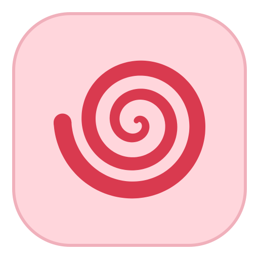
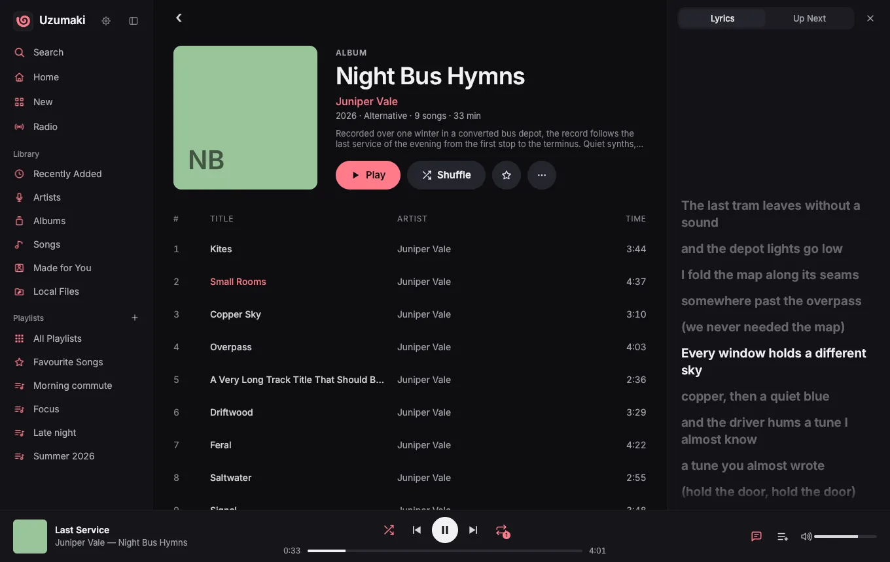
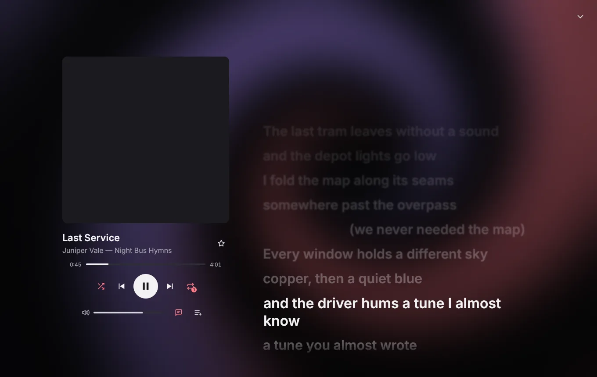
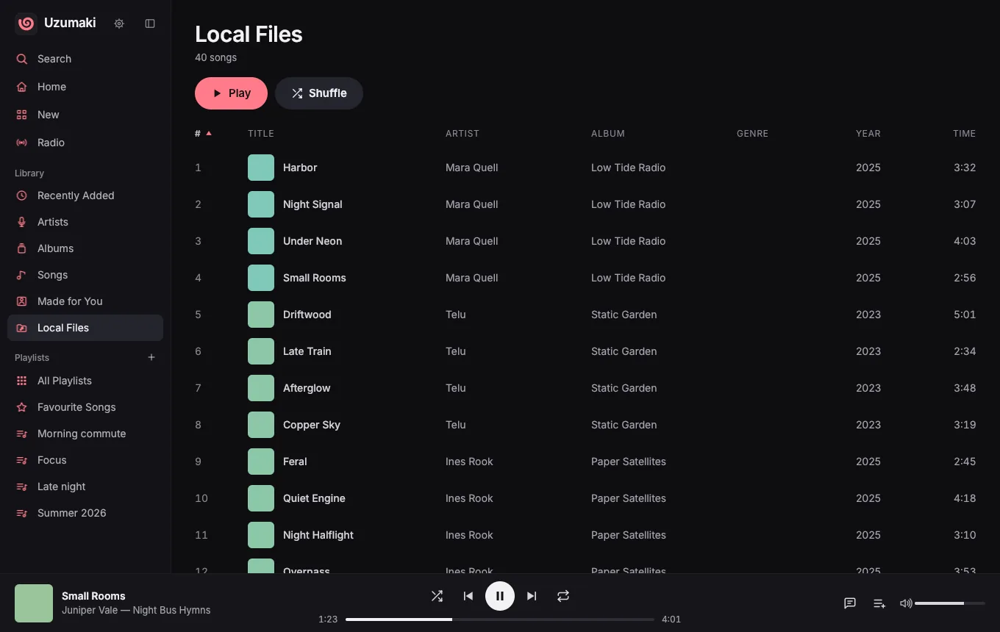
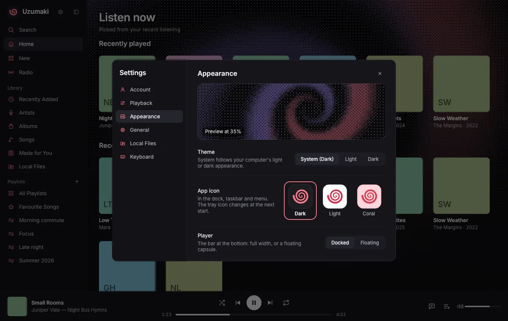

<p align="center">
  
</p>

<h1 align="center">Uzumaki</h1>

<p align="center">
  A native Apple Music desktop client for Linux and macOS.<br>
  Written in Rust and drawn on the GPU. Windows is coming later.
</p>

<p align="center">
  <a href="https://getuzumaki.app">getuzumaki.app</a> ·
  <a href="#install">Install</a> ·
  <a href="CHANGELOG.md">Changelog</a> ·
  <a href="LICENSE">GPL-3.0-or-later</a>
</p>



Uzumaki gives you Apple Music in its own window instead of a browser tab: your library, your playlists,
synced lyrics and your own music files, in one fast app that works with your media keys and your terminal.

Uzumaki is a **public beta**. Expect rough edges, and please report them.

Uzumaki is an independent project. It is not affiliated with or endorsed by Apple. Apple Music is a
trademark of Apple Inc.

## Screenshots

| | |
|---|---|
|  |  |
| Full-screen Now Playing with synced lyrics. | Your own music files, next to Apple Music. |
|  |  |
| Backgrounds, theme, app icon and player style. | Lyrics beside the album you're browsing. |

The screenshots use made-up albums and artists.

## Features

- **Native and GPU-rendered.** Written in Rust with the [Rune](https://github.com/anomalyco/rune) UI
  framework, drawn with the GPU (Vulkan on Linux).
- **Your whole library.** Home, New, Radio, Made for You, Recently Added, Albums, Artists, Songs and
  Playlists. The library is kept on disk, so it opens at once and you can browse it offline.
- **Search** in Apple Music and in your library as you type.
- **Playlists:** create, rename, add and remove songs, and mark Favourite Songs.
- **Synced lyrics,** word by word when Apple has word timing, in full screen or in a side panel.
- **Up Next** with History, Play Next, Add to Queue and drag to reorder. Shuffle, repeat all and repeat one.
- **Resume where you left off.** The last song, its position and Up Next come back, paused, at the next start.
- **Your own music files:** FLAC, MP3, AAC/ALAC, Ogg Vorbis and WAV play inside the app, in the same queue as
  Apple Music. You can also use Uzumaki with local files only, without an Apple Music subscription.
- **Make it yours:** dark, light or system theme, three app icons, and backgrounds (the built-in swirl, your
  own picture or the current cover) with dither, ASCII, halftone, scanline or blur effects.
- **Desktop integration:** media keys and desktop widgets (MPRIS on Linux, Now Playing on macOS), a tray or
  menu bar icon, close to tray, and song notifications.
- **Keyboard first:** you can change every shortcut in Settings → Keyboard.
- **`uzu`:** a command line and terminal player for the running app (see below).
- **Hooks:** your own scripts run on every song change or play/pause.

## Requirements

- **To stream:** an Apple Music subscription. Your own music files play without one.
- **Quality:** Apple Music plays at 256 kbps AAC (64 kbps with Data saver). Lossless and Dolby Atmos are
  not available, because Uzumaki uses Apple's web player.
- **Linux:** x86_64, Wayland or X11, and a GPU with Vulkan (the Vulkan loader and your GPU's driver). On X11
  you also need `libxkbcommon-x11` (`libxkbcommon-x11-0` on Debian and Ubuntu).
- **macOS:** a Mac with Apple silicon (M1 or later), macOS 13 Ventura or later.
- **Disk space:** about 300 MB, most of it for the hidden player (castLabs Electron). On the first start,
  Google's Widevine module downloads by itself.

## Install

> **Uzumaki 0.1.0 is out for macOS and Linux**: a disk image and Homebrew on macOS; the AUR and an AppImage on Linux.
> The install pages on
> [getuzumaki.app](https://getuzumaki.app/#download) have the same steps.

After you install it, start Uzumaki and sign in to Apple Music from the banner (or choose local files only).
You sign in once, in a small Apple sign-in window.

### Arch Linux (AUR)

Two packages are in the AUR. For a quick install, use `uzumaki-bin`: it takes the prebuilt AppImage.

```sh
yay -S uzumaki-bin    # or: paru -S uzumaki-bin
```

If you prefer to build it yourself, use `uzumaki`, which builds from the release's source on your computer
(it installs into `/usr/lib/uzumaki`, with `uzumaki` and `uzu` in `/usr/bin`):

```sh
yay -S uzumaki        # or: paru -S uzumaki
```

The two packages conflict with each other: install only one. Update with `yay -Syu`.

### Other Linux distros (AppImage)

Download [`Uzumaki-x86_64.AppImage`](https://github.com/hanami117/uzumaki/releases/latest/download/Uzumaki-x86_64.AppImage)
(the latest version; each version is also on the [releases page](https://github.com/hanami117/uzumaki/releases)).
It needs glibc 2.35 or newer (Ubuntu 22.04 and later). Then:

```sh
chmod +x Uzumaki-x86_64.AppImage
./Uzumaki-x86_64.AppImage
```

If it doesn't start, your distro may not have FUSE 2. Install `libfuse2` (`libfuse2t64` on newer Debian and
Ubuntu) or `fuse2` (Arch), or start it with `--appimage-extract-and-run`.

### macOS (disk image)

1. Download [`Uzumaki-macOS.dmg`](https://github.com/hanami117/uzumaki/releases/latest/download/Uzumaki-macOS.dmg)
   (the latest version; each version is also on the [releases page](https://github.com/hanami117/uzumaki/releases)).
2. Open it and drag Uzumaki to your Applications folder.

**First launch.** Apple hasn't notarized Uzumaki yet, so macOS stops it the first time. This is expected,
and you do it only once:

1. Open Uzumaki from Applications. macOS says it can't check the app. Close that message.
2. Open System Settings → Privacy & Security and scroll down to Security.
3. Click **Open Anyway** next to Uzumaki, and confirm with your password or Touch ID.

Or, in Terminal, remove the quarantine mark yourself:

```sh
xattr -dr com.apple.quarantine /Applications/Uzumaki.app
```

### macOS (Homebrew)

```sh
brew install --cask hanami117/uzumaki/uzumaki
```

This puts Uzumaki in Applications and adds the `uzu` command. The first-launch steps above still apply.

Homebrew 7 only installs third-party casks you trust. Installing with the full name above trusts the cask for you. If you ran `brew tap hanami117/uzumaki` first and install by the short name, run `brew trust --cask hanami117/uzumaki/uzumaki` once.

To update, and to uninstall (`--zap` also removes your settings and caches):

```sh
brew update && brew upgrade --cask uzumaki
brew uninstall --cask uzumaki
brew uninstall --cask --zap uzumaki
```

### From source (Linux)

You need Rust with cargo, Node.js with npm, git, pkg-config and the ALSA development files (`alsa-lib`,
`libasound2-dev` or `alsa-lib-devel`, depending on your distro). On Arch:
`sudo pacman -S --needed rust nodejs npm git pkgconf alsa-lib`.

```sh
git clone https://github.com/hanami117/uzumaki.git
cd uzumaki
./install.sh
```

The script checks for the tools and tells you what is missing. It builds a release and installs it for your
user, with no sudo, into `~/.local` (set `PREFIX=...` for a different place):

- `~/.local/bin/uzumaki` and `~/.local/bin/uzu`;
- `~/.local/share/uzumaki/bridge/`, the hidden player (castLabs Electron, about 290 MB);
- the app-menu entry and icons.

The first build takes a few minutes. To remove it: `./install.sh --uninstall`.

## Updates

Once a day, Uzumaki asks [getuzumaki.app](https://getuzumaki.app) if there is a new version, and shows a
quiet notice when there is. It never downloads or installs anything by itself. Settings → General has the
switch and a **Check now** button. If a version stops working with Apple Music, the notice says so and
stays until you update; the app keeps running.

How you update depends on how you installed it. Quit Uzumaki first.

- **AUR:** with the rest of your system (`yay -Syu`). The notice tells you to use your package manager.
- **AppImage:** the notice has a Download button. Replace the old file with the new one.
- **Disk image:** download the new DMG and drag the new app over the old one in Applications.
- **Homebrew:** `brew update && brew upgrade --cask uzumaki`.
- **From source:** `git pull && ./install.sh`.

## Using Uzumaki

- **Shortcuts:** Space play/pause, Ctrl+F search, Alt+Left back, Ctrl+, Settings, Ctrl+/ all shortcuts,
  Ctrl+Q quit (⌘ instead of Ctrl on macOS).
- **Close to tray:** closing the window only hides it when Settings → General → Close to tray is on.
- **One copy at a time:** when you start Uzumaki again, the running one comes to the front.
- **Song notifications:** Settings → General → Notify on song change. They show only while the window is
  hidden or behind other apps.
- **Hooks:** put an executable named `on-song-change` or `on-state-change` in `~/.config/uzumaki/hooks/`.
  Uzumaki runs it and gives it the song's details in environment variables. See [docs/hooks.md](docs/hooks.md).

Where Uzumaki keeps its files:

- settings and the Apple Music login: `~/.config/uzumaki`;
- library and cover caches: `~/.cache/uzumaki`;
- update-check state: `~/.local/state/uzumaki`;
- on macOS also `~/Library/Application Support/uzumaki` and the log in `~/Library/Logs/Uzumaki`.

To forget everything, quit Uzumaki and delete those folders.

## uzu: the command line

`uzu` controls the running Uzumaki, the way `mpc` controls mpd. If Uzumaki isn't running, `uzu` starts it in
the background, with no window. Plain `uzu` in a terminal opens a terminal player with the queue,
playlists, search, albums, lyrics and the cover.

```sh
uzu                      # the terminal player (in a pipe: the status)
uzu status               # what plays now
uzu toggle | next | prev # play/pause, next, previous
uzu seek +10 | vol 60    # seek, volume
uzu shuffle | repeat     # shuffle on/off, cycle repeat
uzu playlists            # a numbered list; `uzu play <n|name>` plays one
uzu albums [filter]      # `uzu play -a <n|name>` plays an album
uzu search <words>       # then `uzu pick <n>`, `uzu insert <n>` (play next), `uzu add <n>`
uzu queue                # Up Next; `uzu jump <n>`, `uzu move <from> <to>`, `uzu del <n>`
uzu start | show | quit  # start hidden, show the window, quit
```

A lone number, as in `uzu play 3`, picks from the last list that `uzu` printed. `uzu help` lists everything.
Playlists and albums work offline from the disk cache.

## How it works

Apple Music audio is protected with Widevine DRM. Uzumaki doesn't get around that. It plays music the same
way your browser does:

- A hidden [castLabs Electron](https://github.com/castlabs/electron-releases) window (an Electron build
  with Widevine) loads **music.apple.com** itself. You sign in there, once.
- A small bridge script talks to the page's own player (Apple's MusicKit) for playback, search, your library,
  playlists and lyrics.
- The Rust app draws everything you see. It owns the queue, the caches, the media keys and the tray, and it
  talks to the hidden window with JSON messages.

Uzumaki does not download, convert or decrypt music, and it doesn't need an Apple developer account. Your
own music files are decoded and played inside the app. In local files only mode, no Apple player runs at all.

For the details, see [docs/bridge-protocol.md](docs/bridge-protocol.md).

## Privacy

- **No telemetry, no analytics, no accounts of our own.** The update check below is the only thing Uzumaki
  sends us.
- **Apple Music:** you sign in to Apple directly, in Apple's own sign-in window. Uzumaki never sees your
  password. Your login stays on your computer, in the hidden player's profile.
- **Update check:** once a day, a plain GET of `https://updates.getuzumaki.app/latest.json` with the
  User-Agent `Uzumaki/<version>` and four values: the Uzumaki version, the OS (Linux or macOS), the processor
  type (x86_64 or arm64) and how it was installed (AppImage, AUR, Homebrew, DMG, …), plus a flag on the first
  check of a week and of a month. The server adds one to a counter for that day and that combination; those
  daily counts are all it keeps: no IP address, no install or device id, no cookies. The code is in
  [server/update](server/update). You can turn the check off in Settings → General; then nothing is sent.
- **Covers and lyrics** come from Apple, the same as in the web player.

## Build from source and contribute

See [CONTRIBUTING.md](CONTRIBUTING.md): how to build and run from source, the tests, and how to test
without touching your own Apple Music login.

## License

Copyright © 2026 Thomas Lonigro.

Uzumaki is free software, under the GNU General Public License, version 3 or (at your option) any later
version (`GPL-3.0-or-later`, see [LICENSE](LICENSE)). Third-party code, fonts and the castLabs Electron
player keep their own licences: see [THIRD_PARTY_NOTICES.md](THIRD_PARTY_NOTICES.md).

Website: [getuzumaki.app](https://getuzumaki.app) · Questions or ideas: hello@getuzumaki.app ·
Help with the app: support@getuzumaki.app · X: [@Uzumaki_App](https://x.com/Uzumaki_App)
